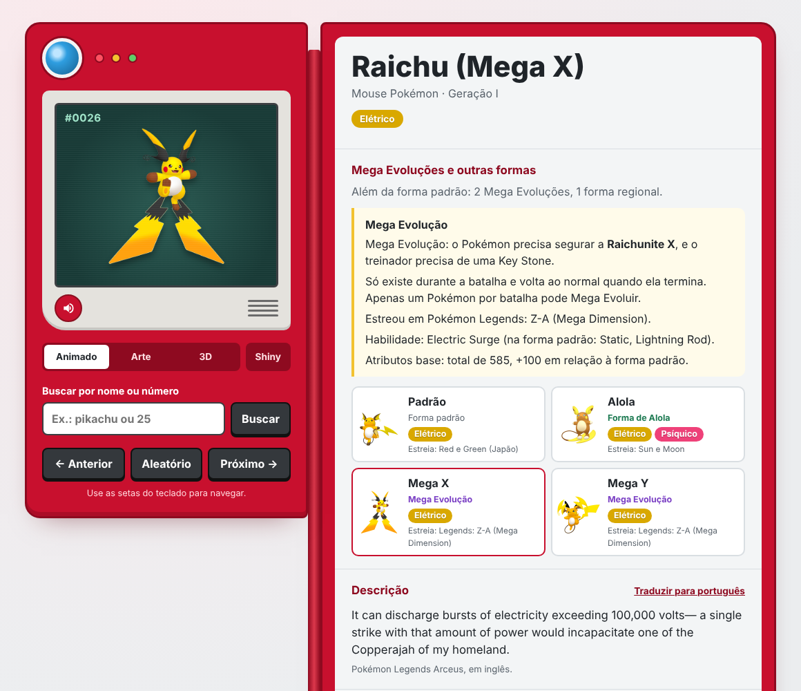

# 📖 Pokédex

Uma Pokédex desenvolvida com HTML, CSS e JavaScript que permite pesquisar Pokémon e visualizar suas informações de forma rápida e intuitiva.

## 🚀 Demonstração

A aplicação permite:

- Buscar Pokémon pelo nome ou número.
- Exibir imagem do Pokémon.
- Visualizar informações básicas do Pokémon.
- Interface inspirada em uma Pokédex clássica.
- Navegação simples e responsiva.

## 🛠️ Tecnologias Utilizadas

- HTML5
- CSS3
- JavaScript
- PokéAPI (caso esteja sendo utilizada para obter os dados)

## 📂 Estrutura do Projeto

```text
pokedex/
│
├── index.html
├── style.css
├── script.js
├── pokedex.png
├── favicon-16x16.png
└── Pokebola-pokeball-png-0.png
```

## ⚙️ Como Executar

1. Clone o repositório:

```bash
git clone https://github.com/callmekaue/pokedex.git
```

2. Acesse a pasta do projeto:

```bash
cd pokedex
```

3. Abra o arquivo `index.html` no navegador.

Ou utilize a extensão **Live Server** do Visual Studio Code para uma melhor experiência.

## 🎯 Objetivo do Projeto

Este projeto foi desenvolvido para praticar:

- Manipulação do DOM com JavaScript
- Consumo de APIs
- Desenvolvimento Front-End
- Estruturação de interfaces web
- Estilização com CSS

## 📸 Preview

Adicione uma captura de tela do projeto:

```md

```

## 📚 Aprendizados

Durante o desenvolvimento foram trabalhados conceitos como:

- Requisições assíncronas
- Tratamento de dados JSON
- Eventos JavaScript
- Responsividade
- Organização de código Front-End

## 🤝 Contribuições

Contribuições são sempre bem-vindas!

1. Faça um Fork do projeto
2. Crie uma Branch

```bash
git checkout -b minha-feature
```

3. Faça Commit das alterações

```bash
git commit -m "Minha nova feature"
```

4. Envie para o GitHub

```bash
git push origin minha-feature
```

5. Abra um Pull Request

## 👨‍💻 Autor

Desenvolvido por **Kauê**.

GitHub:
https://github.com/callmekaue

---

⭐ Se este projeto foi útil para você, considere deixar uma estrela no repositório.
