<p align="center"></p>

<p align="center">
  <a href="https://callmekaue.github.io/pokedex/"></a>
  &nbsp;
  <a href="#002"></a>
</p>

<p align="center">
  
  
  
  
  
  
  
</p>

<p align="center">
  
  
  
  
  
</p>

<p align="center">
  <b>Uma Pokédex para o navegador, com cara de aparelho e ficha de enciclopédia.</b><br>
  Busca por nome ou número, Mega Evoluções com a pedra certa, formas regionais, fraquezas calculadas,<br>
  linha evolutiva, grito de cada Pokémon e uma trilha 8 bits composta para o projeto.
</p>

<p align="center"></p>

<h2 align="center">Índice</h2>

<table align="center">
<tr>
<td><a href="#001"><b>#001</b> &nbsp;O que é</a><br><sub>A ideia e a Pokédex em movimento</sub></td>
<td><a href="#002"><b>#002</b> &nbsp;Teste agora</a><br><sub>QR code e roteiro de 1 minuto</sub></td>
<td><a href="#003"><b>#003</b> &nbsp;A ficha completa</a><br><sub>Tudo o que aparece de cada Pokémon</sub></td>
</tr>
<tr>
<td><a href="#004"><b>#004</b> &nbsp;Mega Evoluções e formas regionais</a><br><sub>Pedra, estreia e o que muda</sub></td>
<td><a href="#005"><b>#005</b> &nbsp;No celular</a><br><sub>Abas, deslize e botões no polegar</sub></td>
<td><a href="#006"><b>#006</b> &nbsp;Animações e som</a><br><sub>Visor que liga, silhueta e trilha 8 bits</sub></td>
</tr>
<tr>
<td><a href="#007"><b>#007</b> &nbsp;De onde vêm os dados</a><br><sub>PokéAPI, sprites e Showdown juntos</sub></td>
<td><a href="#008"><b>#008</b> &nbsp;Por dentro do código</a><br><sub>Cache, corrida de requisições e tabela de tipos</sub></td>
<td><a href="#009"><b>#009</b> &nbsp;Identidade visual</a><br><sub>Cores do aparelho e tipografia</sub></td>
</tr>
<tr>
<td><a href="#010"><b>#010</b> &nbsp;Estrutura e como rodar</a><br><sub>Arquivos, servidor local e GitHub Pages</sub></td>
<td></td>
<td></td>
</tr>
</table>

<p align="center"></p>

<a name="001"></a>
<p align="center"></p>

A Pokédex é aberta como o aparelho dos jogos: à esquerda, a **carcaça vermelha com o visor**, onde o Pokémon aparece animado; à direita, a **ficha**, com tudo o que se sabe sobre ele.

Ela cobre **todas as 1025 espécies**, da Geração I à IX, e as **formas** de cada uma: Megas (inclusive as novas de *Legends: Z-A* e *Mega Dimension*), Regressões Primais, formas de Alola, Galar, Hisui e Paldea, Gigantamax e formas alternativas. Os dados vêm ao vivo da PokéAPI, então novos Pokémon aparecem sem mudar o código.

<p align="center">
  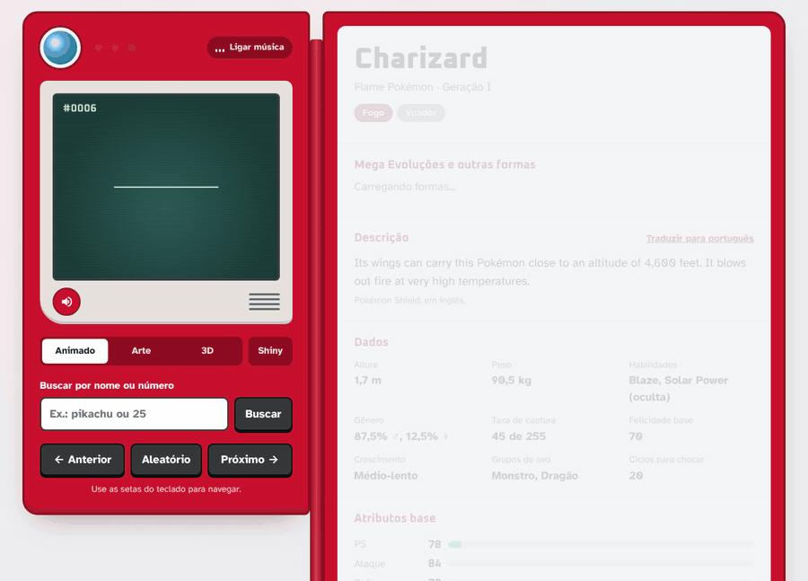<br>
  <sub>Charizard · Mega X · Gigantamax · busca por Raichu · Alola · Mega Raichu X · shiny · arte oficial</sub>
</p>

<a name="002"></a>
<p align="center"></p>

<table>
<tr>
<td width="250" align="center">
  <a href="https://callmekaue.github.io/pokedex/"></a><br>
  <sub>Aponte a câmera do celular</sub>
</td>
<td>

**Acesse:** [callmekaue.github.io/pokedex](https://callmekaue.github.io/pokedex/)

Não tem login nem instalação. Roteiro de 1 minuto:

1. Busque **charizard** e, em *Mega Evoluções e outras formas*, abra a **Mega X**: veja a pedra que ela usa e quanto os atributos sobem.
2. Toque em **Shiny** e depois em **Arte** e **3D** para trocar o estilo da imagem.
3. Clique no **alto-falante** para ouvir o grito.
4. Busque **raichu** e compare a forma de **Alola** com as **Megas X e Y** de *Legends: Z-A*.
5. Use as **setas do teclado** ou, no celular, **deslize o dedo no visor** para passar de Pokémon.
6. Ligue a **música** no canto do aparelho.

Cada Pokémon tem link próprio: [`#charizard-mega-x`](https://callmekaue.github.io/pokedex/#charizard-mega-x), [`#raichu-alola`](https://callmekaue.github.io/pokedex/#raichu-alola), [`#1025`](https://callmekaue.github.io/pokedex/#1025).

</td>
</tr>
</table>

<p align="center"></p>

<a name="003"></a>
<p align="center"></p>

<p align="center">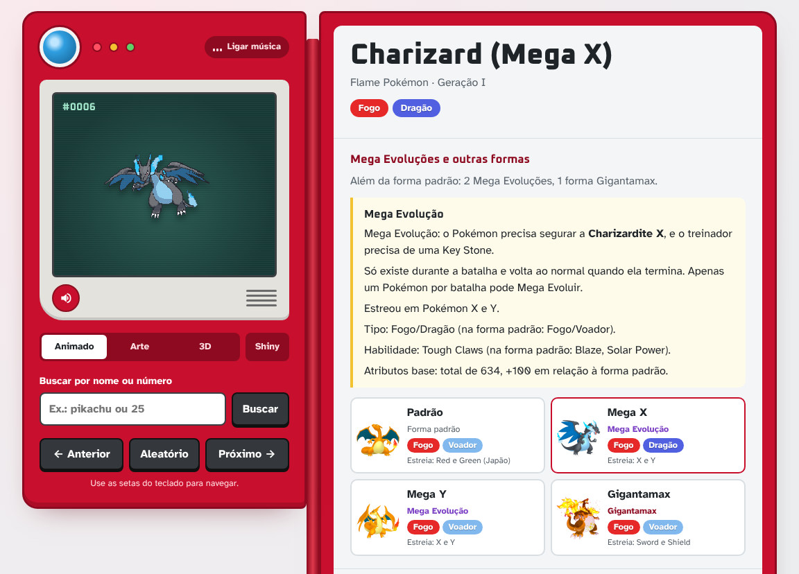</p>

<table>
<tr>
<td width="33%" valign="top">

**Visor**<br>
<sub>Sprite animado, arte oficial ou modelo 3D do Pokémon HOME, com versão shiny. Se um estilo não existe para aquele Pokémon, o visor passa para o próximo sem mostrar imagem quebrada.</sub>

</td>
<td width="33%" valign="top">

**Busca**<br>
<sub>Por nome ou número, com autocompletar das 1351 entradas. Aceita acentos, "#025", "mr. mime" e nomes de forma como "raichu-alola".</sub>

</td>
<td width="33%" valign="top">

**Descrição**<br>
<sub>A entrada mais recente da Pokédex, com o jogo de origem. Um clique traduz para o português e a tradução fica guardada no navegador.</sub>

</td>
</tr>
<tr>
<td valign="top">

**Dados**<br>
<sub>Altura, peso, habilidades (a oculta marcada), proporção de gênero, taxa de captura, felicidade base, crescimento, grupos de ovo e ciclos para chocar.</sub>

</td>
<td valign="top">

**Atributos base**<br>
<sub>Barras de PS, Ataque, Defesa, At. Esp., Def. Esp. e Velocidade com o total. Em uma forma, uma coluna mostra quanto cada um mudou.</sub>

</td>
<td valign="top">

**Fraquezas e resistências**<br>
<sub>Calculadas pela tabela dos 18 tipos: 4×, 2×, ½×, ¼× e imunidades, já combinando os dois tipos do Pokémon.</sub>

</td>
</tr>
<tr>
<td valign="top">

**Evolução**<br>
<sub>A linha inteira, com ramificações como a do Eevee, e a condição de cada etapa: nível, item, troca, amizade, golpe ou horário.</sub>

</td>
<td valign="top">

**Grito e tier**<br>
<sub>O grito oficial de cada Pokémon e, quando existe, o tier competitivo segundo o Pokémon Showdown. Lendários, míticos e bebês ganham selo.</sub>

</td>
<td valign="top">

**Outras fontes**<br>
<sub>Atalhos para a mesma espécie na Pokédex oficial em português, Bulbapedia, Serebii, Pokémon Database e Smogon.</sub>

</td>
</tr>
</table>

<p align="center">
  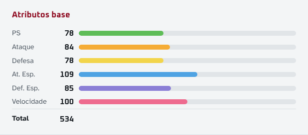
  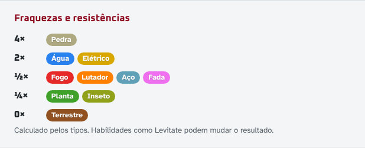
  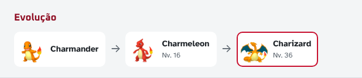
</p>

<p align="center"></p>

<a name="004"></a>
<p align="center"></p>

Toda espécie com mais de uma forma ganha uma seção própria logo abaixo do nome. Cada forma vira um cartão com imagem, tipos e jogo de estreia, e abrir uma forma mostra **o que ela é e o que muda**.

<table>
<tr>
<td width="55%" valign="top">
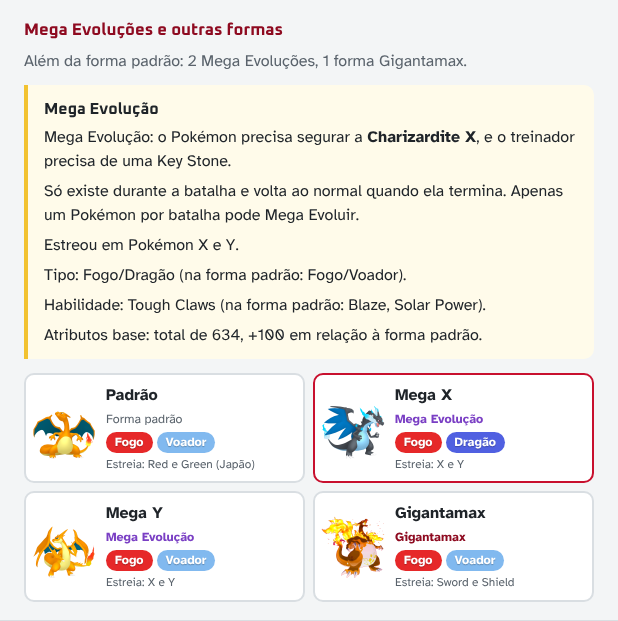
</td>
<td width="45%" valign="top">

**Mega Evolução**<br>
Qual **Mega Pedra** ela usa, as regras de batalha e o jogo de estreia. Casos especiais estão cobertos: o **Mega Rayquaza** pede o golpe *Dragon Ascent*, e **Groudon** e **Kyogre Primais** usam a *Red Orb* e a *Blue Orb*.

**Forma regional**<br>
A região de origem, o que ela inspira e o jogo de estreia.

**Gigantamax**<br>
Quando aparece e por quanto tempo dura.

**Em todas**<br>
O tipo, a habilidade e os atributos comparados com a forma padrão, como o **+100** do Mega Raichu X.

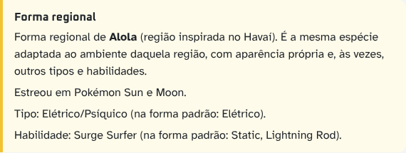

</td>
</tr>
</table>

| Forma | O que precisa | Estreia | O que muda |
|---|---|---|---|
| Mega Charizard X | Charizardite X | X e Y | Fogo/Voador vira Fogo/Dragão, total +100 |
| Mega Dragonite | Dragoninite | *Legends: Z-A (Mega Dimension)* | Habilidade Multiscale, total +100 |
| Mega Raichu X | Raichunite X | *Legends: Z-A (Mega Dimension)* | Habilidade Electric Surge, total +100 |
| Raichu de Alola | Thunder Stone no Pikachu, em Alola | Sun e Moon | Elétrico vira Elétrico/Psíquico |
| Charizard Gigantamax | Fator Gigantamax | Sword e Shield | Só em batalha, por três turnos |

<p align="center"></p>

<a name="005"></a>
<p align="center"></p>

<table>
<tr>
<td width="34%" align="center" valign="top">
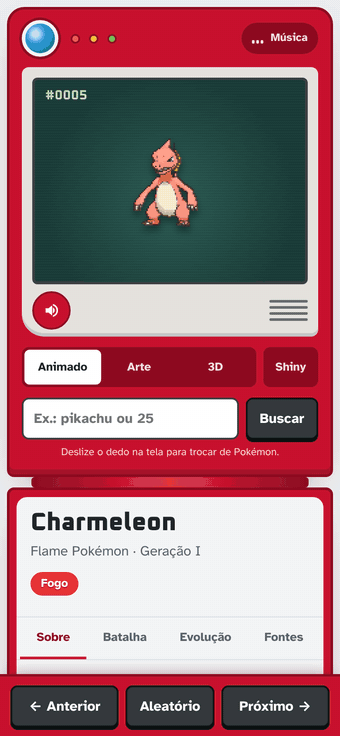
</td>
<td valign="top">

No celular, a Pokédex tem um layout próprio:

- **Aparelho compacto**: o nome do Pokémon aparece sem rolar a página.
- **Deslize no visor** para trocar de Pokémon; rolar a página não dispara a troca.
- **Ficha em abas**: Sobre, Formas, Batalha, Evolução e Fontes. A barra de abas gruda no topo ao rolar, e a aba Formas some quando o Pokémon não tem outras formas.
- **Anterior, Aleatório e Próximo** ficam fixos embaixo, ao alcance do polegar, respeitando a barra do iPhone.
- Botões com pelo menos **44 px**, busca com fonte de **16 px** (o iPhone não dá zoom) e a barra do navegador fica **vermelha**.

<br>

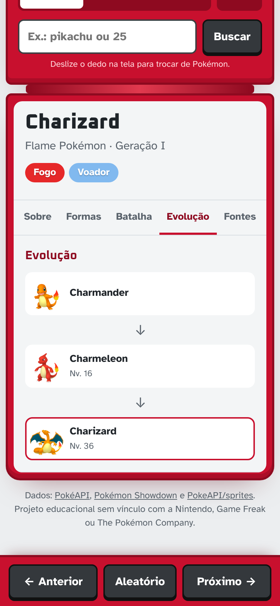
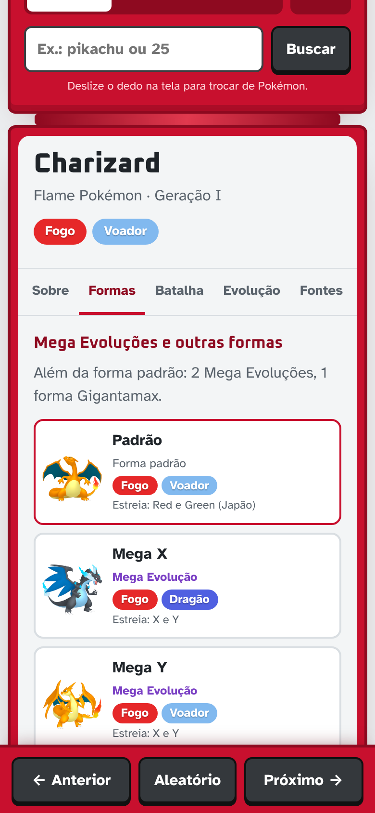
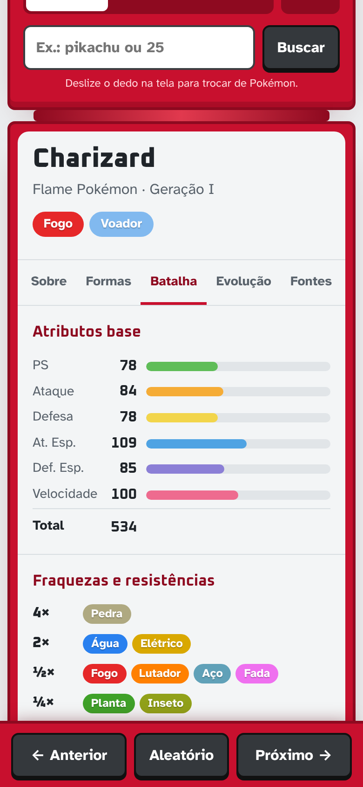

</td>
</tr>
</table>

<p align="center"></p>

<a name="006"></a>
<p align="center"></p>

<table>
<tr>
<td width="50%" valign="top">

**O que se move, e quando**

| Momento | Animação |
|---|---|
| Abrir a página | O visor acende como um monitor antigo e os LEDs ligam um a um |
| Buscando | A lente pulsa e uma faixa de luz percorre o visor |
| Trocar de Pokémon | Ele surge como **silhueta** e ganha cor, entrando pelo lado da navegação |
| Número no visor | Rola até o novo valor: #0004, #0005, #0006 |
| Ativar shiny | Estrelas de brilho saem do visor |
| Grito | As linhas do alto-falante vibram |

Quem ativou **reduzir movimento** no sistema vê tudo parado.

</td>
<td width="50%" valign="top">

**Trilha 8 bits original**

A música de fundo **não é dos jogos**: é uma composição própria, tocada em tempo real pela **Web Audio API**, sem nenhum arquivo de áudio. Uma onda quadrada faz a melodia, uma triangular faz o baixo e um ruído filtrado marca o ritmo, a 132 BPM.

- Começa **desligada**; liga no botão ao lado dos LEDs.
- Entra e sai com **fade**.
- **Abaixa sozinha** enquanto o grito do Pokémon toca.
- A página **lembra** se ela estava ligada e volta no primeiro clique da próxima visita, já que os navegadores bloqueiam som antes de um clique.

</td>
</tr>
</table>

<p align="center"></p>

<a name="007"></a>
<p align="center"></p>

Nenhuma fonte sozinha tem tudo, então a Pokédex junta quatro:

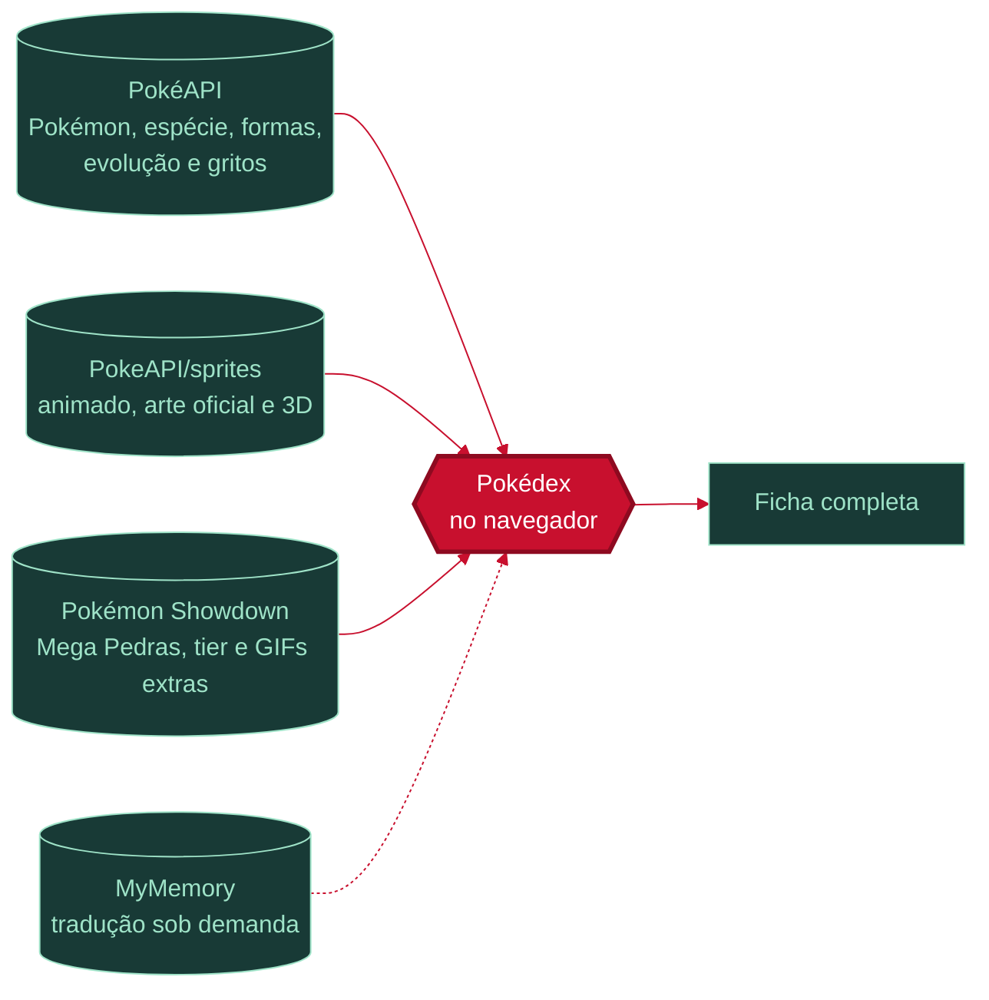

| Fonte | O que entrega | Como é usada |
|---|---|---|
| [PokéAPI](https://pokeapi.co/) | 1025 espécies e 1351 formas, descrições, evoluções, gritos e o jogo de estreia de cada forma | Ao vivo, com cache durante a visita |
| [PokeAPI/sprites](https://github.com/PokeAPI/sprites) | Sprite animado (1011 de 1025), arte oficial e modelo 3D do HOME (1025 de 1025) | Na ordem de preferência do visor |
| [Pokémon Showdown](https://pokemonshowdown.com/) | Lista das Mega Pedras e Orbes, incluindo as de *Legends: Z-A* | Copiada para `data/megas.js` a partir do pacote [@pkmn/dex](https://www.npmjs.com/package/@pkmn/dex), para não baixar 2 MB a cada visita |
| [MyMemory](https://mymemory.translated.net/) | Tradução da descrição | Só quando a pessoa clica em traduzir |

**A imagem nunca quebra.** O visor tenta cada fonte em ordem e passa para a próxima se a anterior não existir:

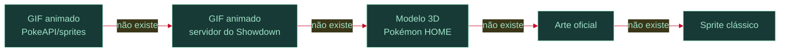

<p align="center"></p>

<a name="008"></a>
<p align="center"></p>

Sem framework, sem build e sem dependências: HTML, CSS e JavaScript puros, com cerca de **2.100 linhas** no total.

<table>
<tr>
<td width="50%" valign="top">

**Cache de requisições**<br>
<sub>Cada endereço da API é buscado uma vez por visita. Voltar a um Pokémon, ou ver a mesma forma em várias partes da ficha, usa o que já está na memória.</sub>

**Corrida de requisições**<br>
<sub>Quem aperta "Próximo" várias vezes seguidas dispara buscas que voltam fora de ordem. Cada busca recebe um número, e só a mais recente pode desenhar a tela.</sub>

**Link para cada Pokémon**<br>
<sub>O endereço ganha `#nome-da-forma`, então qualquer ficha pode ser compartilhada e o botão voltar do navegador funciona.</sub>

</td>
<td width="50%" valign="top">

**Fraquezas por multiplicação**<br>
<sub>A tabela dos 18 tipos guarda só o que é diferente de 1×. Para cada tipo de ataque, os multiplicadores dos dois tipos do Pokémon são multiplicados entre si.</sub>

```js
const mult = defTypes.reduce(
  (m, def) => m * (TYPE_CHART[atk][def] ?? 1), 1
);
// Charizard (Fogo/Voador) contra Pedra: 2 × 2 = 4×
```

</td>
</tr>
</table>

<p align="center"></p>

<a name="009"></a>
<p align="center"></p>

<p align="center">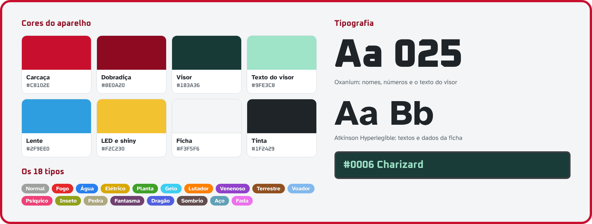</p>

O desenho parte do aparelho aberto: a **carcaça vermelha** é a única área de cor forte, o **visor verde-escuro** com linhas de varredura concentra a atenção no Pokémon, e a **ficha clara** fica neutra para os 18 tipos brilharem. O **amarelo** dos LEDs só aparece no que está ligado: shiny, música e o botão ativo.

**Oxanium**, de traço quadrado e técnico, faz os nomes, os números e o texto do visor. **Atkinson Hyperlegible**, criada para leitura fácil, faz os textos e dados da ficha.

<p align="center"></p>

<a name="010"></a>
<p align="center"></p>

```
pokedex/
├── index.html                 # estrutura do aparelho e da ficha
├── style.css                  # carcaça, visor, ficha, animações e layout do celular
├── script.js                  # busca, fontes de dados, formas, fraquezas e evolução
├── music.js                   # trilha 8 bits original (Web Audio API)
├── data/
│   └── megas.js               # Mega Pedras e Orbes, vindas do Pokémon Showdown
├── favicon-16x16.png
└── pokedex-readme-arquivos/   # imagens, GIFs e SVGs animados deste README
```

**Rodar no computador.** Não há instalação. Abra o `index.html` com dois cliques ou use um servidor local:

```bash
npx serve .
# ou
python -m http.server 8080
```

A Pokédex precisa de internet para buscar os dados.

**Publicar no GitHub Pages.**

1. Envie os arquivos para o repositório, com o `index.html` na raiz.
2. Em **Settings → Pages**, escolha **Deploy from a branch**, a branch `main` e a pasta `/ (root)`.
3. Em alguns minutos a Pokédex fica no ar em `https://<usuario>.github.io/pokedex/`.

<p align="center"></p>

<p align="center">
  Desenvolvido por <b><a href="https://github.com/callmekaue">Cicero Kauê Alves da Silva</a></b><br>
  <sub>Engenharia de Software · UNICID</sub>
</p>

<p align="center">
  <sub>Projeto de estudo, sem fins comerciais e sem vínculo com a Nintendo, a Game Freak, a Creatures ou a The Pokémon Company.<br>
  Pokémon e os nomes dos personagens são marcas registradas de seus donos. Os dados são da PokéAPI e do Pokémon Showdown.</sub>
</p>
