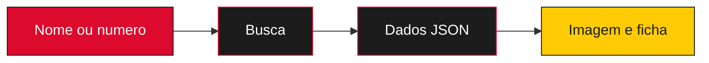

<div align="center">
  
</div>

<p align="center">
  <a href="https://www.pokemon.com/">
    
  </a>
  <a href="https://pokeapi.co/">
    
  </a>
  <a href="https://github.com/callmekaue/pokedex">
    
  </a>
  <a href="https://github.com/callmekaue">
    
  </a>
</p>


<p align="center">
  <a href="#apresentacao">Apresentação</a> ·
  <a href="#demonstracao">Demonstração</a> ·
  <a href="#preview">Preview</a> ·
  <a href="#tecnologias">Tecnologias</a> ·
  <a href="#estrutura">Estrutura</a> ·
  <a href="#como-executar">Como executar</a> ·
  <a href="#objetivo">Objetivo</a> ·
  <a href="#aprendizados">Aprendizados</a> ·
  <a href="#contribuicoes">Contribuições</a> ·
  <a href="#aviso">Aviso</a>
</p>

<h2 id="apresentacao">Apresentação</h2>

Esta **Pokédex** é um estudo de Front-End em HTML, CSS e JavaScript. A proposta é pesquisar Pokémon e ler as informações na tela com o ritmo de um aparelho clássico: vermelho na carcaça, tela escura no centro, busca direta pelo nome ou pelo número.

A interface busca a leitura rápida de uma Pokédex de bolso, não o cliente oficial dos jogos. Os dados da espécie vêm de uma API pública quando a aplicação está configurada para isso; Pokémon, Pokédex e nomes das espécies continuam sendo marcas de seus respectivos donos.

<h2 id="demonstracao">Demonstração</h2>

A aplicação permite:

- buscar Pokémon pelo nome ou pelo número
- exibir a imagem do Pokémon encontrado
- visualizar informações básicas da entrada
- usar um layout inspirado em uma Pokédex clássica
- navegar de forma simples e responsiva

O fluxo previsto é o de um dispositivo: informar o identificador, consultar o registro e ver o resultado na “tela”.



<h2 id="preview">Preview</h2>

Quando o arquivo `pokedex.png` estiver na raiz do repositório, o GitHub exibe a captura abaixo.


Se a imagem não carregar, abra `index.html` no navegador para ver a interface completa.

<h2 id="tecnologias">Tecnologias</h2>

<p align="center">
  
</p>

<p align="center">
  
  
  
  
</p>

| Tecnologia | Papel |
| --- | --- |
| HTML5 | Estrutura da Pokédex e da área de busca |
| CSS3 | Carcaça vermelha, tela, tipografia e responsividade |
| JavaScript | Eventos, DOM e leitura dos dados |
| PokéAPI | Fonte pública típica para nome, número, sprite e ficha |

A PokéAPI é citada como origem prevista dos registros. A aplicação precisa de conexão com a internet para buscar dados remotos.

<h2 id="estrutura">Estrutura do projeto</h2>

```text
pokedex/
├── index.html
├── style.css
├── script.js
├── pokedex.png
├── favicon-16x16.png
├── Pokebola-pokeball-png-0.png
└── README.md
```

Não há etapa de build. HTML, CSS e JavaScript na raiz são suficientes para abrir o projeto no navegador.

<h2 id="como-executar">Como executar</h2>

```bash
git clone https://github.com/callmekaue/pokedex.git
cd pokedex
```

Abra `index.html` no navegador ou sirva a pasta com a extensão Live Server no Visual Studio Code / Cursor.

<h2 id="objetivo">Objetivo</h2>

Praticar, em uma interface reconhecível:

- manipulação do DOM com JavaScript
- consumo de APIs
- desenvolvimento Front-End
- estruturação de interfaces web
- estilização com CSS

<h2 id="aprendizados">Aprendizados</h2>

- requisições assíncronas
- tratamento de dados JSON
- eventos em JavaScript
- responsividade
- organização de código Front-End

<h2 id="contribuicoes">Contribuições</h2>

Sugestões de busca, acessibilidade e fidelidade visual são bem-vindas.

```bash
git checkout -b minha-feature
git commit -m "Minha nova feature"
git push origin minha-feature
```

Abra um Pull Request em [github.com/callmekaue/pokedex](https://github.com/callmekaue/pokedex).

<h2 id="autor">Autor</h2>

Desenvolvido por **Kauê**.

GitHub: [github.com/callmekaue](https://github.com/callmekaue)

<h2 id="aviso">Aviso</h2>

Pokémon e Pokédex são marcas de Nintendo, Game Freak e Creatures. Este repositório é um projeto educacional de Front-End, **sem vínculo oficial** com a The Pokémon Company ou com os jogos.

A PokéAPI é um serviço da comunidade e também não é um produto oficial.


<p align="center">
  <strong>Pokédex</strong><br>
  vermelho · tela · registro<br>
  HTML · CSS · JavaScript
</p>

<div align="center">
  
</div>
